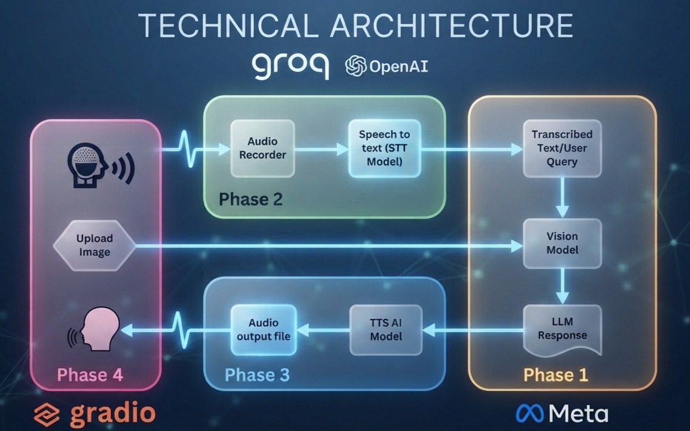

# 🩺 AI Doctor — Multimodal Vision & Voice Assistant

An AI-powered medical assistance prototype that combines **voice input, speech recognition, image analysis, and AI-generated voice responses** into a single interactive application.

Users can describe their symptoms through voice, upload an image for analysis, and receive an AI-generated text response along with a spoken response.

> **Disclaimer:** This project is developed for educational and demonstration purposes only. It is not a substitute for professional medical advice, diagnosis, or treatment.

---

## 🏗️ Technical Architecture

The application integrates speech-to-text, multimodal AI inference, image processing, and text-to-speech into a unified workflow.



### Workflow Phases

- **Phase 1 — AI Analysis:** The transcribed patient query and uploaded image are processed to generate an AI response.
- **Phase 2 — Patient Voice Processing:** Patient audio is captured and transcribed using Groq's speech-to-text model.
- **Phase 3 — Voice Response Generation:** The generated response is converted into audio using ElevenLabs.
- **Phase 4 — User Interaction:** The Gradio interface allows users to submit audio and images and receive text and audio responses.

---

## ✨ Features

- 🎙️ **Patient Voice Input:** Record or upload audio describing symptoms.
- 📝 **Speech-to-Text:** Convert spoken symptoms into text using Groq's Whisper transcription model.
- 🖼️ **Image Analysis:** Submit an image for analysis by a vision-capable AI model.
- 🤖 **AI-Generated Responses:** Generate a response using the patient's transcribed query and image context.
- 🔊 **Text-to-Speech:** Convert the AI-generated response into speech using ElevenLabs.
- 🌐 **Interactive Web Interface:** Access the application through a Gradio interface.
- 🔐 **Secure Configuration:** Load API credentials through environment variables rather than hardcoding them.

---

## 🛠️ Tech Stack

| Technology | Purpose |
|---|---|
| Python | Core application development |
| Gradio | Interactive web interface |
| Groq API | Speech transcription and AI inference |
| Whisper `whisper-large-v3` | Patient speech transcription |
| Vision-capable language model | Image analysis and response generation |
| ElevenLabs | AI-generated voice responses |
| gTTS | Alternative text-to-speech implementation |
| Pillow | Image handling |
| PyDub | Audio conversion and processing |
| FFmpeg | Audio format processing |
| SpeechRecognition | Speech recognition utilities |
| PyAudio | Microphone access for local audio recording, where used |
| python-dotenv | Local environment variable management |
| Docker | Application containerization |
| Render | Cloud deployment target |

*The vision model used at runtime depends on the model configured in `app.py` and its availability through your Groq account.*

---

## 📂 Project Structure

```text
MultiModel-AI-Doctor/
├── app.py                  # Gradio interface and application workflow
├── brain.py                # Image encoding and AI image analysis
├── voice_of_patient.py     # Patient audio recording and transcription
├── voice_of_doc.py         # Text-to-speech functionality
├── flowchart.png           # Technical architecture diagram
├── requirements.txt        # Python dependencies
├── Dockerfile              # Docker build configuration
├── .dockerignore           # Files excluded from Docker builds
├── .gitignore              # Files excluded from Git
└── README.md               # Project documentation
```

---

## ⚙️ Getting Started

### Prerequisites

Before running the project, ensure you have:

- Python 3.11 or a compatible Python version
- Git
- FFmpeg installed and accessible on your system PATH
- A Groq API key
- An ElevenLabs API key for voice generation

### 1. Clone the repository

```bash
git clone https://github.com/Manideep-Maddileti/MultiModel-AI-Doctor.git
cd MultiModel-AI-Doctor
```

### 2. Create a virtual environment

**Windows:**

```bat
python -m venv aidoc
aidoc\Scripts\activate
```

### 3. Install dependencies

```bash
python -m pip install --upgrade pip
pip install -r requirements.txt
```

If PyAudio installation fails on Windows, install the appropriate PortAudio/PyAudio dependencies for your Python version.

Install FFmpeg separately if it is not already available on your system.

### 4. Configure environment variables

Create a `.env` file in the project root:

```env
GROQ_API_KEY=your_groq_api_key
ELEVENLABS_API_KEY=your_elevenlabs_api_key
```

Replace the placeholder values with your own API credentials.

**Security best practices:**

- Never commit `.env` to GitHub.
- Ensure `.env` is listed in `.gitignore`.
- Never hardcode API keys in Python source files.
- Configure the same variable names in your cloud deployment environment.

### 5. Run the application

```bash
python app.py
```

Open the local URL displayed in the terminal, typically:

```text
http://127.0.0.1:7860
```

---

## 🔄 Application Workflow

1. The user records or uploads an audio description of symptoms.
2. The application sends the audio to Groq's transcription API.
3. The user uploads an image for analysis.
4. The application encodes the image and combines its context with the transcribed symptoms.
5. A configured vision-capable model processes the request and generates a text response.
6. ElevenLabs converts the generated response into audio.
7. Gradio displays the transcription and AI response and provides the audio output.

---

## 🚀 Deployment on Render

The project includes a Dockerfile for containerized deployment.

### Deployment steps

1. Push the latest project files to GitHub.
2. Sign in to [Render](https://dashboard.render.com/).
3. Create a new **Web Service** and connect the GitHub repository.
4. Select Docker as the runtime.
5. Configure the required environment variables.
6. Deploy the service and inspect the build logs.
7. Open the generated public URL and test the complete application.

### Required environment variables

| Variable | Description |
|---|---|
| `GROQ_API_KEY` | Authentication for Groq API requests |
| `ELEVENLABS_API_KEY` | Authentication for ElevenLabs text-to-speech |

The application should listen on `0.0.0.0` and use the port supplied through the `PORT` environment variable.

**Deployment note:** The Docker build requires the appropriate Linux dependencies for audio processing. PyAudio may require PortAudio development headers. Hosting limits, API quotas, model availability, and network connectivity can affect application performance.

---

## 🔑 API and Configuration Notes

- Groq provides the transcription and configured AI inference capabilities.
- ElevenLabs provides generated voice output.
- gTTS is included as an alternative speech-generation implementation.
- API keys must be stored in environment variables.
- API usage may be subject to provider quotas, rate limits, and billing.

---

## ⚠️ Limitations and Responsible Use

- This project is an educational prototype, not a clinically validated medical system.
- Image analysis may be inaccurate, incomplete, or misleading.
- AI-generated responses should not be treated as confirmed diagnoses.
- Audio quality, image quality, network conditions, API limits, and model availability can affect results.
- Do not rely on this application for emergency care, medication decisions, or definitive diagnoses.
- Avoid uploading identifiable patient information or confidential medical records.
- Consult a qualified healthcare professional for actual medical concerns.

---

## 🔮 Future Enhancements

- 🌍 Multilingual speech recognition and responses.
- 🩻 Improved handling of different medical image types.
- 📚 Retrieval-augmented generation using trusted medical references.
- 🛡️ Additional medical safety checks and uncertainty handling.
- 🧪 Automated testing and systematic evaluation of model outputs.
- 📊 Logging, monitoring, and API usage tracking.
- ☁️ Improved deployment reliability and performance.
- ♿ Better accessibility and user experience.

---

## 👨‍💻 Author

**Manideep Maddileti**

- GitHub: [@Manideep-Maddileti](https://github.com/Manideep-Maddileti)
- Project Repository: [MultiModel-AI-Doctor](https://github.com/Manideep-Maddileti/MultiModel-AI-Doctor)

---

## 📄 License

No license has been specified yet. If you want others to use, modify, or distribute this project, consider adding an appropriate `LICENSE` file.

---

**Built as an educational project exploring multimodal AI, computer vision, speech technologies, and AI-powered application development.**